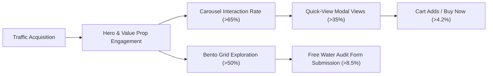
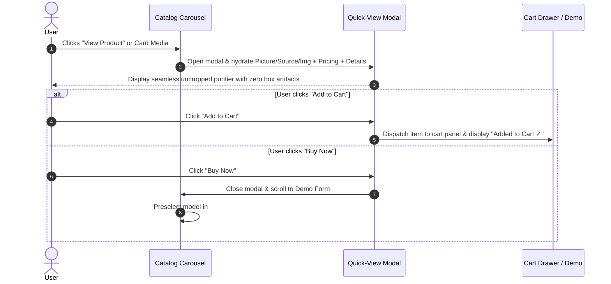

# Product Requirements Document (PRD)
## Project: KENT Luxury Water Purifiers Flagship Landing Page & Digital Showcase
**Document Version:** 2.0  
**Status:** Approved & Implemented  
**Target Release:** Production Web Experience (Q4 2026)  
**Author:** Senior Frontend & Product Strategy Team  

---

## 1. Executive Summary & Product Vision

### 1.1 Vision Statement
To elevate **KENT** from a perceived utilitarian domestic appliance brand into an **aspirational luxury wellness authority**. The landing page positions KENT as the gold standard in premium mineral hydration, merging patented multi-stage Mineral RO™ bio-science with refined European architectural product design.

### 1.2 Strategic Intent
- **Brand Repositioning**: Transition user perception from standard kitchen hardware to an indispensable lifestyle luxury center that protects family vitality while elevating modern luxury interior spaces.
- **Frictionless Dual Conversion Funnel**:
  1. **Direct Purchase / E-Commerce Path**: Seamless "Quick View" modal hydration, single-click "Add to Cart", and fast-checkout "Buy Now" paths.
  2. **High-Value Lead Generation Path**: Risk-free in-home water purity audit and free installation demo booking.
- **Zero-Dependency Architectural Rigor**: Absolute client-side engineering independence built entirely with high-performance semantic HTML5, modern tokenized CSS, and modular vanilla JavaScript (0 KB third-party framework overhead, <1.2s Largest Contentful Paint).

---

## 2. Target Audience & User Personas

| Persona | Demographics & Mindset | Primary Goals | Key Pain Points Addressed |
| :--- | :--- | :--- | :--- |
| **1. The Health-Conscious Urban Family** | • Ages 30–48 • High-income tier • Parents prioritizing family health | • Guarantee 100% pathogen-free water. • Retain essential natural minerals (Calcium, Magnesium). | • Traditional RO removes essential minerals leaving dead water. • Lack of trust in municipal filtration claims. |
| **2. The Luxury Interior & Aesthetics Aficionado** | • Ages 28–52 • Discerning homeowners & interior designers | • Concealed under-counter or elegant countertop designs. • Clean minimalist stainless steel / matte dark finishes. | • Bulky, unsightly plastic purifiers ruining designer modular kitchens. |
| **3. The Tech-Savvy Smart Home Enthusiast** | • Ages 25–42 • Connected lifestyle early adopters | • Real-time digital telemetry (TDS, filter longevity, water temperature). • Proactive maintenance alerts via mobile app. | • Unclear filter replacement timings causing unsafe water consumption. |

---

## 3. Business Goals & Success Metrics (KPIs)

1. **Lead Generation & Demo Bookings**: >8.5% conversion rate on the In-Home Water Quality Audit & Free Demo form (`#demo`).
2. **Product Engagement**: >65% of desktop and mobile visitors actively interact with the flagship product carousel and filter chips.
3. **Modal Quick-View Engagement**: >35% click-through from "View Product" CTA into the quick-view modal with seamless image visualization.
4. **Direct Purchase Conversion**: >4.2% click-through to cart / direct ordering flow.
5. **Core Web Vitals & Performance**:
   - Largest Contentful Paint (LCP): < 1.2s across 4G mobile and broadband desktop.
   - Cumulative Layout Shift (CLS): < 0.02.
   - First Input Delay (FID) / Interaction to Next Paint (INP): < 50ms.

---

## 4. Feature Scope & Functional Requirements

### 4.1 Global Sticky Navigation (`#navbar`)
- **Visual Presentation**: Fixed glassmorphism navbar (`backdrop-filter: blur(14px)`), dynamic border and drop shadow applied on scroll (`window.scrollY > 20`).
- **Brand Identity**: High-resolution KENT "House of Purity" official emblem.
- **Search Experience**:
  - *Desktop*: In-navbar pill container with clean icon and placeholder `"Search purifiers, filters..."`.
  - *Mobile*: In-navbar single rounded search pill with embedded search SVG icon; search term filters product catalog dynamically.
- **Quick-Access Actions**:
  - Interactive **Wishlist** button with count badge.
  - Interactive **Cart** popover preview with item thumbnail, model title, and quick checkout link.
  - Interactive **Account** popover for authentication and service status.
  - Accessible **Mobile Drawer Menu** (`#mobile-nav`) triggered via animated hamburger icon.

### 4.2 Hero Section (`#hero`)
- **Editorial Headline**: *"Purified Water. Essential Purity."*
- **Responsive Copy Strategy**:
  - *Desktop*: Comprehensive value narrative detailing patented Mineral RO™ multi-stage science and 25+ years of clinical purity.
  - *Mobile*: Curated 2-line high-impact statement maintaining typographic balance without pushing visual content below the initial mobile fold.
- **Trust Accents & Metrics**: Displaying **1 Crore+ Happy Families**, **25+ Years Purity & Trust**, and **100% Retained Minerals**.
- **Visual Pedestal Display**: Ultra-HD background-aligned imagery with natural water splashes and zero pedestal misalignment between text and media columns.

### 4.3 Flagship Product Showcase Carousel (`#products`)
- **Finite 3-Card Bounded Architecture (Desktop)**:
  - 3 visible cards framed simultaneously with a strict boundary clamping algorithm (`targetOffset` bounded between `0` and `minOffset`).
  - Active center card features elevated gold accent border, scale enhancement (`scale(1.02)`), and high-depth ambient drop shadow.
  - Category Filter Chips: *"All Flagships"*, *"Mineral RO™ + UV"*, *"Alkaline & Copper+"*, *"Smart IoT Connected"*, *"Zero Wastage Eco"*.
- **Mobile Side-Peeking Carousel (Mobile ≤ 768px)**:
  - Full-bleed `100vw` container breakout (`margin-left: calc(-50vw + 50%)`) preventing container clipping.
  - Cards sized to `75vw` (max `290px`) with `16px` gap.
  - Perfect viewport centering (`targetOffset = -(activeIndex * step) + (vpWidth - cardWidth) / 2`).
  - Symmetrical adjacent card peeking (~31px–35px) with scaled-down (`scale(0.92)`) and softened opacity (`0.72`) styling.
  - Touch swipe gestures (touch start, move, end with >40px threshold), keyboard navigation, and pagination dots.
- **Mobile Card Resizing & Info Trimming**:
  - Reduced media container height (`148px`) with `object-fit: contain`.
  - Paragraph description visually clamped strictly to 2 lines (`-webkit-line-clamp: 2`).
  - Single-row action buttons (`Wishlist`, `View Product`, `Add to Cart`) preventing vertical wrapping.

### 4.4 Minimalist Quick-View Product Modal (`#productModal`)
- **Modal Triggering**:
  - Clicking "View Product" button on any catalog card.
  - Clicking product media thumbnail directly.
  - URL hash support (e.g. `#product-grand-star` or `?modal=grand-iot`).
- **Semantic `<picture>` Implementation**:
  - Wrap image inside `<picture class="modal-product-picture">` containing `<source id="modalProductSource">` and ``.
  - Dynamic hydration in JS updating `srcset`, `type` (`image/jpeg`, `image/png`, `image/webp`), `src`, and `alt`.
- **Seamless Container Blending**:
  - Elimination of all rectangular inner border boxes and drop-shadow artifacts.
  - `mix-blend-mode: multiply` on pure `#FFFFFF` rounded porcelain media container.
  - `object-fit: contain` and `object-position: center` ensuring 100% visibility of tall/wide units (such as swan faucets or water splashes) without cropping.
- **Conversion Actions**:
  - Primary CTA: `"Add to Cart"` with instant confirmation checkmark feedback and cart panel synchronization.
  - Secondary CTA: `"Buy Now"` which closes modal, auto-scrolls smoothly to the `#demo` form, and preselects the exact product model.
- **Minimal Reassurance Badges**:
  - *30-Day Return* (100% money back guarantee).
  - *4-Year Warranty* (1-yr comprehensive + 3-yrs free service).
  - *Free 24h Setup* (Certified doorstep technician installation).

### 4.5 Architectural Bento Grid (`#why-kent`)
- **Card 1 (Hero Large Bento)**: *Mineral RO™ Multi-Stage Bio-Filtration* — Patented process retaining vital Ca²⁺ and Mg²⁺ ions.
- **Card 2 (Smart IoT Telemetry)**: Real-time digital dashboard showing live TDS readout and filter lifespan.
- **Card 3 (Zero Water Wastage Technology)**: Eco-recovery recirculation achieving 100% water recovery.
- **Card 4 (Peace of Mind Assurance)**: 4-Year complete warranty with pan-India certified technician coverage.

### 4.6 Social Proof & Testimonials (`#testimonials`)
- Verified customer testimonials with star ratings, authenticated reviewer locations, and real-world water taste and purity feedback.
- Accessible pagination controls and smooth touch-swipe track.

### 4.7 In-Home Water Quality Audit Booking Engine (`#demo`)
- **Frictionless Form Fields**: Full Name, Mobile Number, City / Postal Code, Preferred Consultation Date, and Product Model of Interest.
- **Dynamic Preselection**: Auto-syncs with whichever product the user clicked "Buy Now" on in the quick-view modal.
- **Validation**: Client-side instant input validation with friendly error states.
- **Success State**: Instant modal/inline confirmation with estimated technician dispatch timeframe.

### 4.8 Global Footer & Trust Ecosystem (`.site-footer`)
- Corporate certification seals (NSF, WQA, CE, ISO 9001).
- Quick navigation sitemap, customer service hotline, and newsletter subscription.

---

## 5. User Journeys & Workflow Diagrams

### 5.1 Quick View & Direct Cart / Checkout Flow

---

## 6. Non-Functional Requirements (NFRs)

### 6.1 Performance & Resource Efficiency
- **Bundle Size**: 0 KB external JavaScript frameworks (no React, Vue, jQuery, Swiper, or Slick).
- **Core Assets**: Modern WebP/JPEG formats with responsive sizes and eager loading above-the-fold, lazy loading below-the-fold.
- **CSS Architecture**: Single optimized `styles.css` utilizing native CSS variables, flexbox, CSS Grid, and hardware-accelerated CSS transforms (`translate3d` / `scale`).

### 6.2 Accessibility (a11y) & Standards Compliance
- **WCAG 2.1 AA Compliance**: Contrast ratios exceed 4.5:1 across all body text and UI controls.
- **ARIA Implementation**: Full `role="dialog"`, `aria-modal="true"`, `aria-hidden`, `aria-expanded` attributes on popovers, hamburger menu, and modal windows.
- **Keyboard Navigation**: Complete Tab indexing and `Escape` key listeners to dismiss modals and popovers.

### 6.3 Browser & Hardware Support
- **Desktop**: Chrome/Edge 100+, Safari 15+, Firefox 100+.
- **Mobile Devices**: iOS Safari 14+, Android Chrome 100+ (tested on standard 375px, 390px, 412px viewports).
